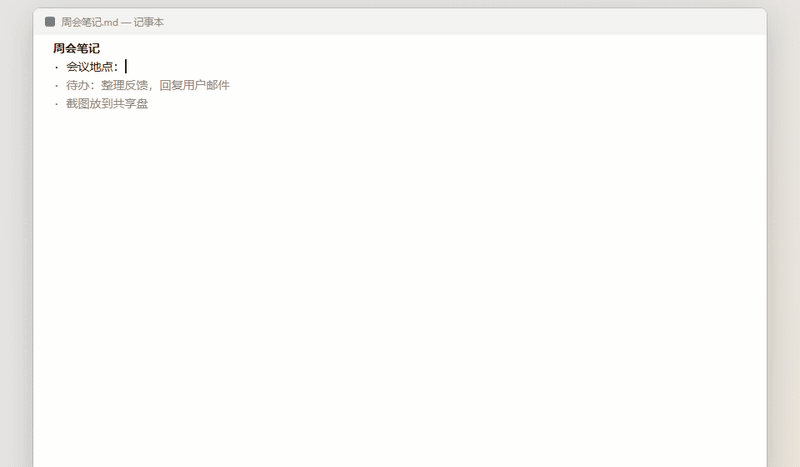
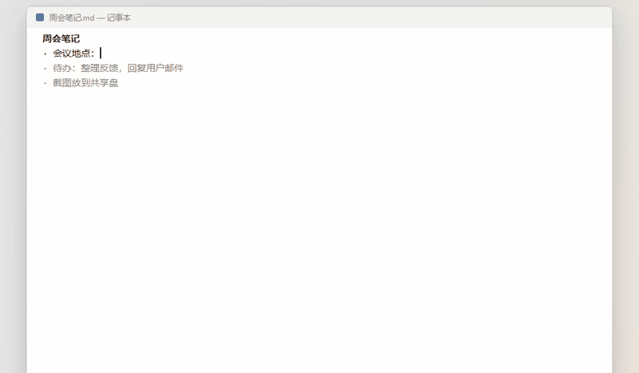
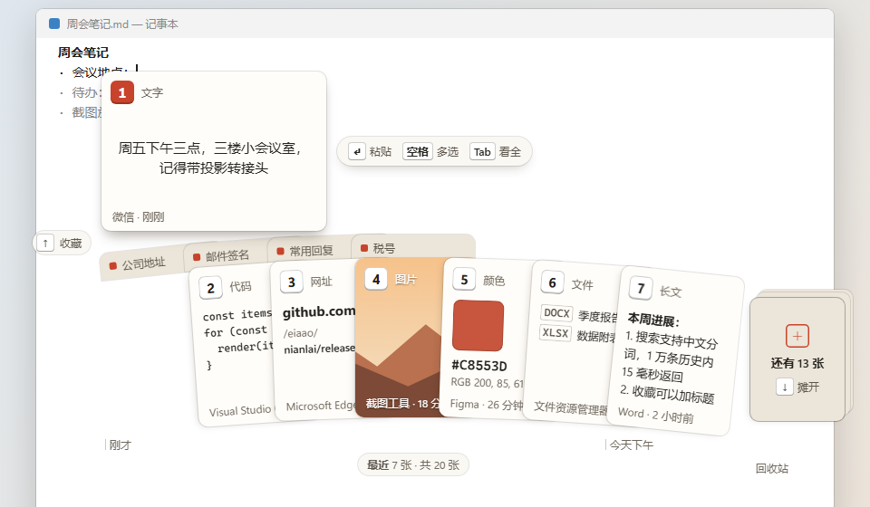
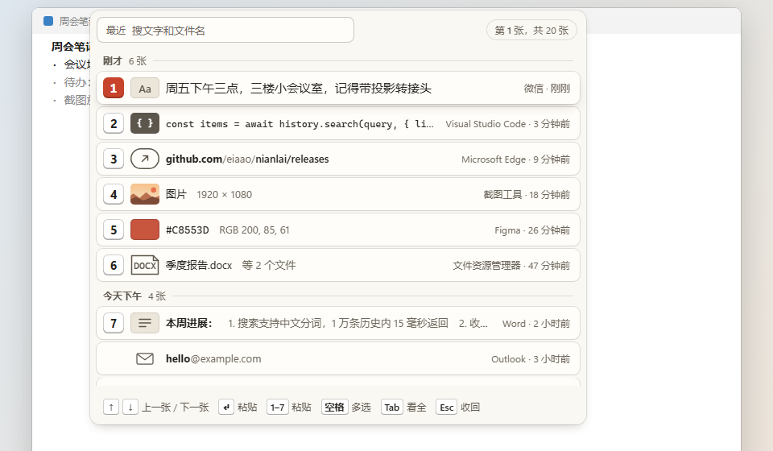
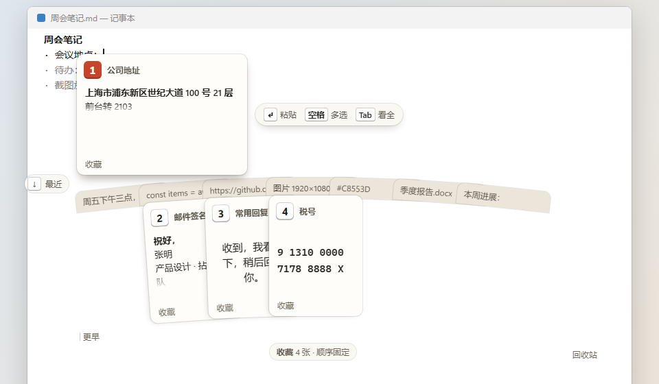
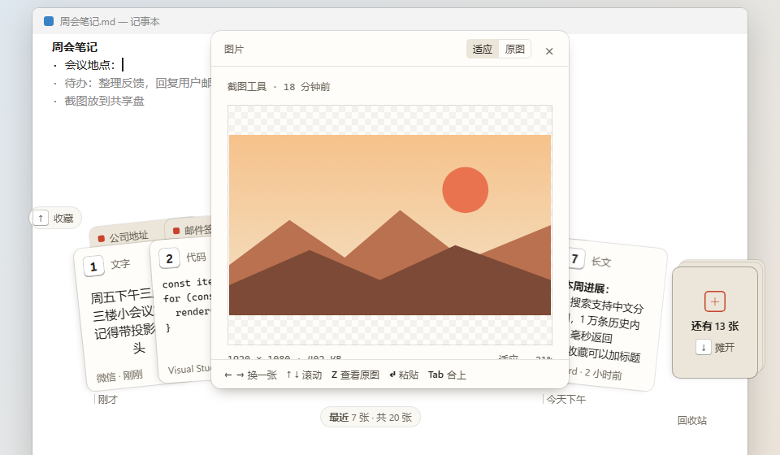
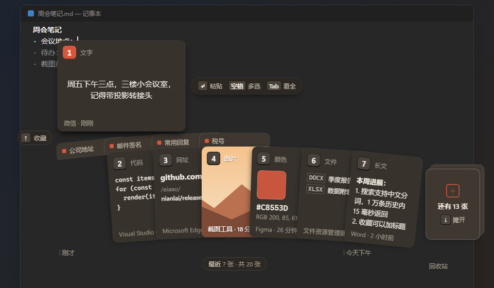
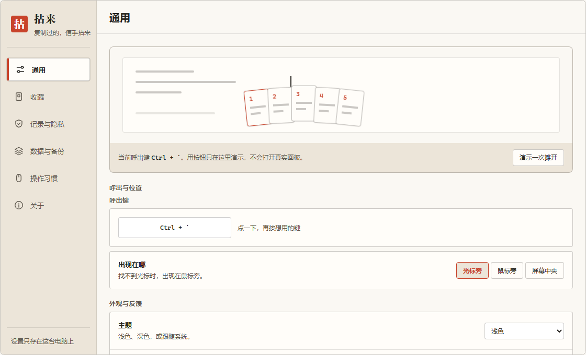
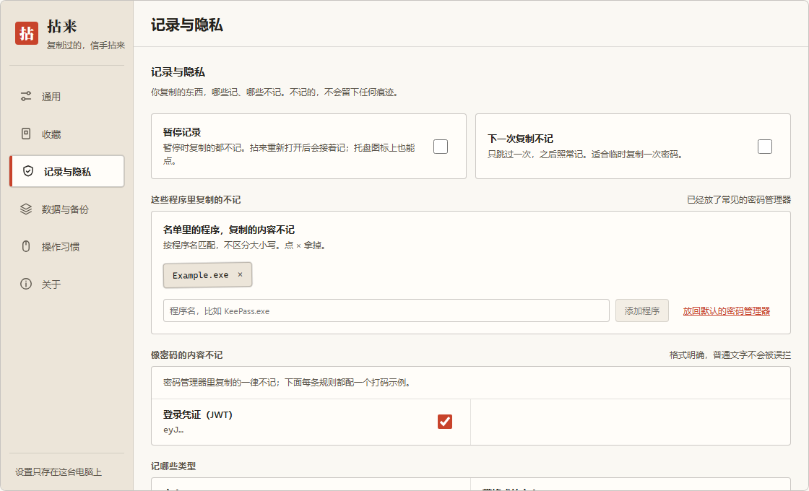
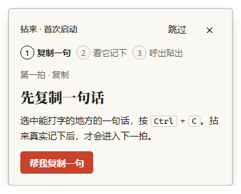

  

<h1 align="center">拈来 Nianlai</h1>

<b>取历史之一缕，付当前之一键。</b>

  
  
  
  

  <a href="#下载">下载</a> · <a href="#使用">使用</a> · <a href="#数据与隐私">数据与隐私</a> · <a href="#反馈与参与">反馈与参与</a> · <a href="#english">English</a>

拈来是一个开源的剪贴板历史工具（Windows，macOS Beta）：复制过的内容都留在本机，按一下快捷键呼出，挑一条直接粘贴到你正在用的程序里。呼出面板时**不抢焦点**，光标还在原来的位置；打字就能搜，中文也能搜。

  
   Ctrl+` 呼出 → ← → 换牌 → ↑ 收藏 → ↓ 摊开

> **0.1.1**：支持 Windows x64，以及 macOS 13+（Beta）。数据库格式升级时会自动迁移，升级前自动备份。

## 特点

- **不打断手头的事**：面板不激活窗口，目标程序的光标和选区保持原样；选中后直接粘贴回去。
- **键盘优先**：最近 7 张像一手牌，数字键 1–7 直接粘贴，Enter 粘贴，Ctrl+Enter 粘贴为纯文本，Shift+Enter 只复制。
- **打字就搜**：全文搜索，支持中文；1 万条历史里搜索也在十几毫秒内完成。
- **粘贴可靠**：发键前检查目标和剪贴板状态，尽量确认确实粘贴进去了；没把握时明确告诉你“已复制，请手动粘贴”，不会悄悄失败。
- **收藏**：常用的内容设为收藏后单独一手、顺序固定，可以加标题和备注，不随历史过期。
- **手牌与摊开**：平时是一手扇面，要找更早的就把牌摊开成一列，连续滚动、按时间分组；深浅主题跟随系统。
- **保留格式**：文字、富文本、图片、文件都按原格式记录，并显示来源程序的图标。
- **本地优先**：数据只存在本机，不联网，不上传。

## 看一看

<table>
  <tr>
    <td width="50%" valign="top">
      <b>打字就搜</b> 
      呼出后直接打字，中文也能搜；搜“设置”会置顶一张“打开设置”。  
      
    </td>
    <td width="50%" valign="top">
      <b>一手牌</b> 
      最近 7 张认得出是什么：代码、网址、图片、颜色、文件、长文各有牌面。  
      
    </td>
  </tr>
  <tr>
    <td valign="top">
      <b>摊开</b> 
      按 ↓ 或滚轮把牌摊成一列，按时间分组，连续往下翻。  
      
    </td>
    <td valign="top">
      <b>收藏</b> 
      按 ↑ 切到收藏：顺序固定，可以起标题、写备注，不随历史过期。  
      
    </td>
  </tr>
  <tr>
    <td valign="top">
      <b>看全</b> 
      Tab 看完整内容或原图，可以选一段只复制这一段。  
      
    </td>
    <td valign="top">
      <b>深色主题</b> 
      浅色、深色或跟随系统。  
      
    </td>
  </tr>
  <tr>
    <td valign="top">
      <b>设置</b> 
      六页设置：通用、收藏、记录与隐私、数据与备份、操作习惯、关于。  
      
    </td>
    <td valign="top">
      <b>记录与隐私</b> 
      暂停记录、下一次复制不记、按程序排除、像密码的内容不记。  
      
    </td>
  </tr>
</table>

以上画面由 <code>tools/readme-media.mjs</code> 用真实界面组件和虚构的演示数据生成。

## 下载

在 [Releases](https://github.com/eiaao/nianlai/releases) 下载 `nianlai-<版本>-windows-x64-portable.zip`，解压到任意可写的文件夹，双击 `nianlai.exe` 即可，不需要安装。

- 需要 Microsoft Edge WebView2 运行时（Windows 11 已自带；Windows 10 若缺失，请安装微软的 WebView2 Evergreen 运行时）。
- 程序暂未签名。首次运行时 Windows SmartScreen 可能拦截，确认文件来自本仓库后，点“更多信息 → 仍要运行”。每个版本都附有 SHA-256 校验值。
- 开机自启：在托盘菜单里勾选。

**macOS（Beta）**：支持 macOS 13 及更新版本，在 Releases 下载 `nianlai-<版本>-macos-universal.dmg`（Apple Silicon 与 Intel 通用）。

- 程序暂未签名。首次打开被拦截时，在“系统设置 › 隐私与安全性”里选择“仍要打开”。
- 直接粘贴需要在“辅助功能”里允许拈来；升级后可能需要重新勾选授权。
- macOS 上默认呼出键是 **⌃`**（Control+`），可在菜单栏图标的“设置…”里改。

## 使用

按 **Ctrl+`**（Esc 下面的反引号键）呼出面板，再按一次收起。快捷键可以在托盘菜单的“设置…”里改。

| 按键 | 作用 |
|---|---|
| 1–7 | 粘贴对应的一张（摊开时是看得见的前 7 条，键帽上标着数字） |
| Enter | 粘贴当前这张；有已选时按顺序一起粘贴 |
| ← → | 上一张 / 下一张（任何状态都一样，搜索中也是） |
| ↑ | 扇面里：切到收藏；再按回到最近 |
| ↓ / PageDown | 最近扇面里：摊开成一列；摊开里 ↓ 下一条、PageDown 翻一屏 |
| Home / End | 摊开里：收回扇面 / 最后一条 |
| 直接打字 | 搜索最近和收藏（自动摊开）；搜索时数字是输入，用 Ctrl+1–7 粘贴 |
| Ctrl+Enter | 粘贴为纯文本 |
| Shift+Enter | 只复制当前一张，不粘贴（有已选时不执行，会提示） |
| Tab | 看全（超长内容、原图）；看全里 Z 切换原图 |
| 空格 | 多选；Backspace 放回最后选的一张 |
| Ctrl+Shift+Enter | 已选的逐张放：之后每按一次 Ctrl+V 粘贴下一张，Esc 结束 |
| Ctrl+D | 设为收藏 / 取消收藏 |
| Delete | 把当前这张放进回收站（收藏的要按住不放，进度走满才删）；搜索时用 Ctrl+Delete |
| Ctrl+Z | 撤销最近的删除，关掉面板再打开也可以；可以连续撤销 |
| Esc | 逐层退出：看全 → 搜索 → 已选 → 摊开 → 收起面板 |

按住 Ctrl 或 Shift 稍等片刻，按键提示会换成对应的组合键。鼠标悬停在牌上会拈起它，单击直接粘贴。滚轮向下摊开，摊开里滚轮逐条。

在面板里搜“设置”（或 settings）会置顶一张“打开设置”，按 Enter 就打开设置窗口。

**第一次启动**时有一张小纸笺带你走一遍“复制 → 呼出 → 粘贴”，每一步都等你真的做到了才往下走；之后可以在设置的“关于”页再看一次。

 

退出：托盘图标右键“退出”，或按 Ctrl+Alt+Shift+Q。

**目标是管理员权限的程序时**：面板照常呼出、可以打字搜索；但普通权限的拈来无法向它发送按键，会把内容放进剪贴板并提示你手动按 Ctrl+V。

## 数据与隐私

- 历史记录存在 `%LOCALAPPDATA%\Nianlai\data`，设置在 `%APPDATA%\Nianlai\settings.json`，日志在 `%LOCALAPPDATA%\Nianlai\logs`。
- 不联网：没有统计、遥测，也不检查更新。
- 遵守密码管理器等程序设置的“不要记录”标记，这类内容不会进入历史。
- 日志不记录剪贴板正文和窗口标题。
- 程序崩溃后会自动重启，24 小时内最多 3 次；数据库升级前自动备份。
- 复制文件时只记路径，不复制文件本身；原文件被移走或删除后，条目会标成“已失效”。
- 不会自动删除任何记录。设置的“数据与备份”页能看到占用，手动清理失效条目、截图和临时文件；清理的条目先进回收站，7 天内可以恢复。

## 反馈与参与

问题和建议欢迎提 [Issue](https://github.com/eiaao/nianlai/issues)。想从源码构建或参与开发，见 [CONTRIBUTING.md](CONTRIBUTING.md)。

## English

Nianlai (拈来) is an open-source clipboard history manager for Windows and macOS. Press <kbd>Ctrl</kbd>+<kbd>`</kbd> to open the panel **without stealing focus**, type to search (including Chinese), and press Enter or 1–7 to paste straight into the app you were using. Everything stays on your machine — no network access. Downloads are on [Releases](https://github.com/eiaao/nianlai/releases): a portable zip for Windows x64, and a macOS 13+ Beta as a universal DMG (unsigned; allow it under Accessibility to paste directly). On macOS the default hotkey is <kbd>Control</kbd>+<kbd>`</kbd>.

## 许可证

[MIT](LICENSE)
